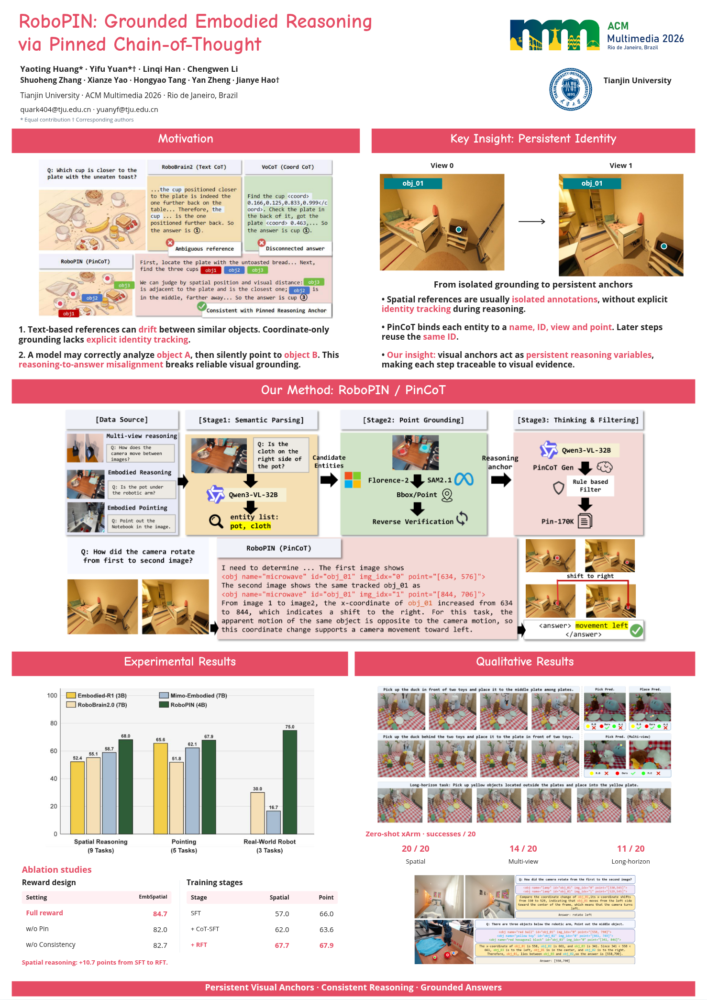

# MM-Poster

RoboPIN · ACM Multimedia 2026 · **A0 竖版，841 × 1189 mm**

## 最新版本：HTML 与可编辑 PPT

- [HTML 版预览](output/RoboPIN_HTML_preview.png)
- [单文件 HTML](output/RoboPIN_A0.html)：下载后用浏览器打开，图片和字体已内嵌，无需联网。
- [可编辑 PowerPoint](output/RoboPIN_A0_editable.pptx) · [配套字体安装包](output/RoboPIN_fonts.zip)
- [PPT 配套预览](output/RoboPIN_preview.png) · [印刷 PDF](output/RoboPIN_A0_portrait.pdf)
- [HTML 导出 PDF](output/RoboPIN_A0_HTML.pdf)
- [当前版本与源码包](output/RoboPIN_poster_package.zip)

GitHub 不直接运行 HTML；在文件页面点击 **Download raw file**，保存后双击打开。PDF / PPTX 同样通过该按钮下载。



## 当前版本：恢复 Key Insight，Method 使用完整论文原图

[查看 Our Method 局部大图](output/detail-method.png)

- **Key Insight** 恢复此前的双视角照片、obj_01 标记与三条说明。
- **Our Method** 直接使用论文图 2 的完整原图：上方数据构造流程，下方具体 CoT 推理示例。删除上一版自行重画的四步骤及 A/B 分区。
- 删除二维码占位框和 PAPER / CODE 标签，不预留二维码位置。
- 保留珊瑚红标题条、Comic Neue Bold 标题和 Open Sans 正文。

[方法原图说明](design/method_revision.md)

### 保留的论文证据

- 性能图直接裁取论文首页原图，保留原始柱体、图例、数值和标签。
- 真机展示恢复完整三行：空间、多视角、长时序任务。
- 消融区改为**奖励函数消融**和**三阶段训练表现**，移除 cross-step 指标及精选基准表。
- 精简坐标、聚合口径等辅助文字；保留论文原图、五模块结构和正式标识，不添加 Figure / Table 编号图注。
- 两种格式同步调整间距、方法区高度和结果区布局。

奖励消融来自论文 Table 5：84.7 / 82.0 / 82.7。训练阶段来自 Table 6：Spatial 57.0 → 62.0 → 67.7；Point 66.0 → 63.6 → 67.9。保留 Point 中间阶段下降的事实。来源与口径说明放在 [SOURCES.md](SOURCES.md)，不挤占海报。

## 如何编辑

**HTML** 是真实 HTML/CSS 元素，正文可选择；不是整页图片或 PDF 嵌入。自带缩放适配及打印按钮。可以直接编辑 HTML 的文字与样式，或修改共享生成器后重建。

**PPTX** 的文字、消融表格单元内容及周边版式可编辑；完整 Method、性能图、论文插图和徽标是独立可替换图片，图内元素保留论文原样。编辑 PPT 前请安装 [字体目录](assets/fonts) 中的三个 TTF 文件，避免字体替换；字体也已包含在源码包内。HTML 和 PDF 已嵌入字体。

直接修改 HTML/PPTX 后请另存文件；生成器不会反向读取这些修改，重新运行会覆盖生成产物。

## 重建与验证

```bash
python -m pip install -r requirements.txt
python scripts/prepare_assets.py
python scripts/build_poster.py
python scripts/validate_outputs.py
python scripts/render_html.py
```

HTML 渲染另需系统 Chromium（默认 `/usr/bin/chromium`）。标题和正文字体随仓库存放于 `assets/fonts/`，备用等宽字体使用系统 DejaVu Sans Mono。以上脚本均支持常用 Linux 环境，生成和验证脚本可使用 `--output-dir` 指定输出目录。

- `scripts/build_poster.py`：共享版式、文案；生成 PDF、PPTX 和 HTML。
- `scripts/html_poster.py`：原生 HTML/CSS 元素、内嵌字体和图片。
- `scripts/prepare_assets.py`：从论文提取原图；精确位置记录在 `assets/crop-provenance.json`。
- `scripts/render_html.py`：Chromium 离线渲染、截图、打印 PDF、文字边界及手机宽度检查。
- `output/validation.json` / `output/html-validation.json`：最新验证记录。
- `poster_config.json`：正式会议标识与学校校徽路径。

已检查 PDF 字体、页面尺寸、文字碰撞、图片比例和 PPTX 中的原图字节；HTML 已实际浏览器渲染并检查。PPTX 完成结构检查，尚未在 Microsoft Office 中渲染。

ZIP 包含当前 HTML、PPTX、主 PDF、预览、素材和重建源码。为避免重复，HTML 导出 PDF、历史版二进制文件及历史预览不重复装入 ZIP，可分别从仓库下载。

## 历史版本与技能

[此前三版对照](design/variants/README.md) 仅供回溯，当前主文件已更新。历史源码可从 Git 提交记录查看。

已配置上游 [Paper2Poster/Paper2Poster](https://github.com/Paper2Poster/Paper2Poster) 的轻量 [paper2poster-poster skill](.agents/skills/paper2poster-poster/SKILL.md)，使用其原文核对、文案精简和视觉检查流程。产物由本仓库渲染器生成；需要模型 API 的完整 PosterAgent 未运行。

[文案](poster_copy.md) · [版式](poster_layout.md) · [运行说明](poster_runbook.md)

## 印刷信息

本版不放二维码，也不保留占位符。会议要求见 [Paper Presenters Guidelines](https://2026.acmmm.org/site/paper-presenters-guidelines.html) 和 [Poster Printing Service](https://2026.acmmm.org/site/poster-printing-service.html)。最终文件按 `ACMMM2026_Poster_Track_OpenReviewID.pdf` 命名，Track 与 OpenReview ID 待补充。本项目未提交会议文件或印刷订单。
