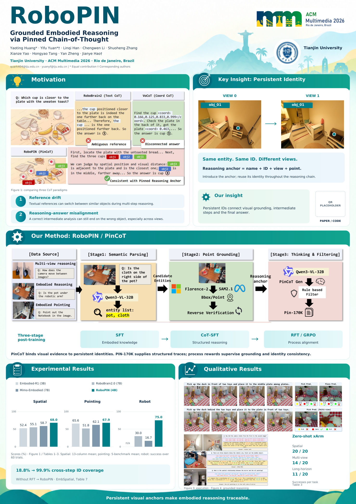

# MM-Poster

RoboPIN · ACM Multimedia 2026 · **A0 竖版，841 × 1189 mm**

## 查看与下载

- [当前海报预览](output/RoboPIN_preview.png)
- [印刷 PDF](output/RoboPIN_A0_portrait.pdf)
- [可编辑 PowerPoint](output/RoboPIN_A0_editable.pptx)
- [完整素材与源码包](output/RoboPIN_poster_package.zip)
- [当前视觉模板重建说明](design/styled_mockup_alignment.md) · [上一轮布局映射](design/reference_alignment.md) · [此前设计迭代](design/iteration_review.md)
- [科学数据来源与待核实项](SOURCES.md)

在 GitHub 文件页点击 **Download raw file** 下载 PDF、PPTX 或 ZIP。



## 当前设计

当前版本以用户最新提供的 **RoboPIN AI 视觉稿**为具体模板，重建其渐变圆角标题栏、图标、分区比例、浅色提示卡、里约剪影与底部波浪。不是仅替换标题或沿用之前的平面分栏版。

- 页眉：放大 RoboPIN 字标；右侧会议标识、圆形天津大学校徽及校名。
- 左上 Motivation：原论文对比图，带圆形编号的两条浅蓝提示。
- 右上 Key Insight：双视角、浅蓝机制卡、浅绿 Our insight、虚线二维码占位。
- 中间通栏 Method：原流程图、浅青训练卡、方法总结。
- 底部：带图标的 Experimental Results / Qualitative Results；底部波浪上的一句结论。

装饰背景通过图像工具参考用户视觉稿生成，仅含里约剪影、浅色波浪与页边装饰；文字、图表、渐变、图标和卡片继续用独立对象绘制，科研图像均来自原论文。二维码仍为占位符。

[当前版本](output/RoboPIN_preview.png) · [视觉重建说明](design/styled_mockup_alignment.md) · [上版对照](design/iterations/05-before-styled.png)

## Paper2Poster skill

已配置仓库级技能 [paper2poster-poster](.agents/skills/paper2poster-poster/SKILL.md)，复制自上游 [Paper2Poster/Paper2Poster](https://github.com/Paper2Poster/Paper2Poster) 的轻量技能包，附有版本来源和 MIT 许可证。在支持仓库技能发现的 Codex 中可使用 `$paper2poster-poster`；也可直接要求代理阅读该文件。

本次**实际使用了技能的内容提炼、版式规划和视觉复查流程**，由本仓库确定性渲染器生成 PDF / PPTX。需要模型 API 密钥和额外依赖的 `PosterAgent.new_pipeline` **未运行**；轻量 skill 本身不需要这些依赖。

对应技能交付文件：

- [海报简报](poster_brief.md)
- [最终文案](poster_copy.md)
- [版式说明](poster_layout.md)
- [运行说明](poster_runbook.md)
- [Paper2Poster 兼容样式配置](assets/poster.yaml)，放在 `assets/paper.pdf` 旁，本仓库渲染器也实际读取此文件。

## 编辑与重建

PowerPoint 中的文字、柱状图、坐标轴、数值、训练流程均可编辑；01/02 的论文原图、机器人实拍和徽标是独立图片对象，其内部文字保留原样。推荐安装 DejaVu Sans 字体，避免换行变化。

直接改 PPTX 后，请在 PowerPoint 中另存并导出 PDF。源码生成器不会反向读取这些修改，重新运行会覆盖生成产物。

本包根目录执行：

```bash
python scripts/prepare_assets.py
python scripts/build_poster.py
python scripts/validate_outputs.py
```

当前环境依赖已就绪。新环境可先执行：

```bash
python -m venv .venv
.venv/bin/python -m pip install -r requirements.txt
```

将上面的 `python` 换成 `.venv/bin/python` 即可。生成器默认使用 `/usr/share/fonts/truetype/dejavu/`；其他系统需修改 `font_dir`。

- `assets/poster.yaml`：字体、配色、A0 尺寸和基线配色。
- `performance_data.json`：原始成绩和聚合口径；图高用未四舍五入的均值。
- `poster_config.json`：正式会议标识、学校校徽和二维码路径。
- `scripts/build_poster.py`：位置与具体文案。
- `output/validation.json`：页面、字体、原图、11 根可编辑柱体及原生文字碰撞检查结果。

已完成实际 PDF 渲染和视觉复查；PowerPoint 检查为结构验证，未使用 Microsoft Office 渲染。

## 印刷前

会议和天津大学正式标识已嵌入并保持原比例；右下角二维码仍为占位符。确定项目地址后，在 `poster_config.json` 的 `qr_file` 设置真实二维码图片路径，重建并实际扫码检查。

官网要求见 [Paper Presenters Guidelines](https://2026.acmmm.org/site/paper-presenters-guidelines.html) 和 [Poster Printing Service](https://2026.acmmm.org/site/poster-printing-service.html)。按 100% 实际尺寸送印，不添加会改变页面大小的出血或裁切标记。最终文件名按 `ACMMM2026_Poster_Track_OpenReviewID.pdf` 重命名；Track 与 OpenReview ID 尚未提供。本项目未提交任何会议文件或印刷订单。

论文的机器人试验次数图注冲突等事项保留在 `SOURCES.md`，供作者印刷前核对。
