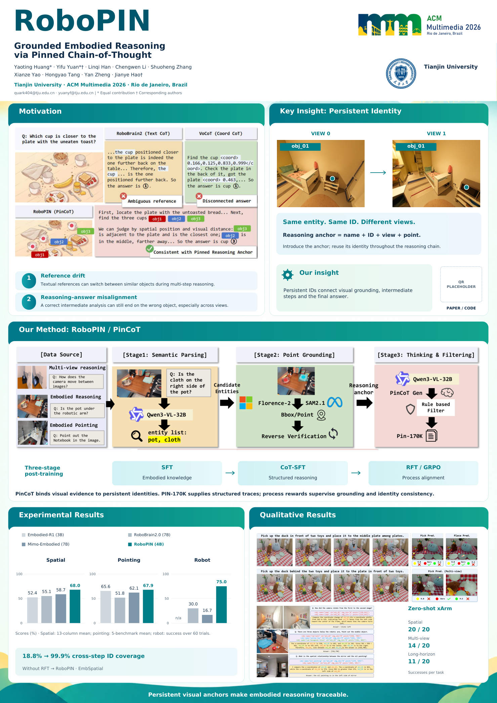
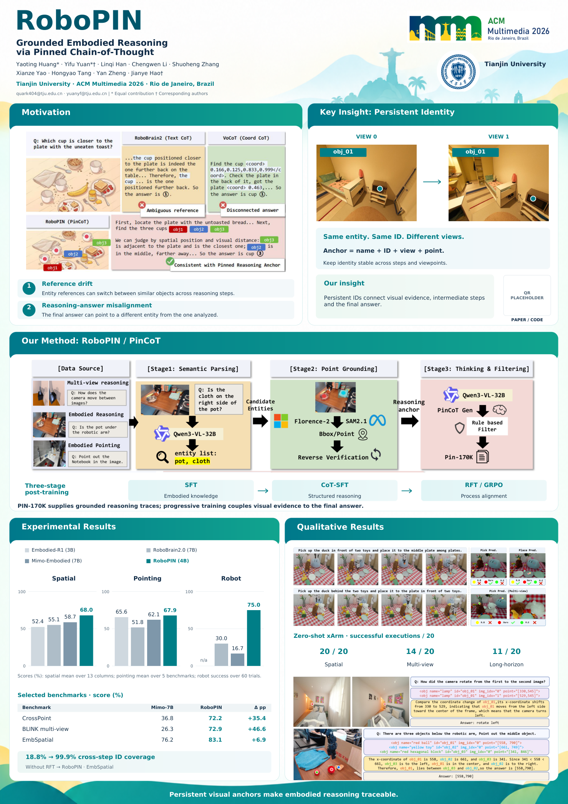
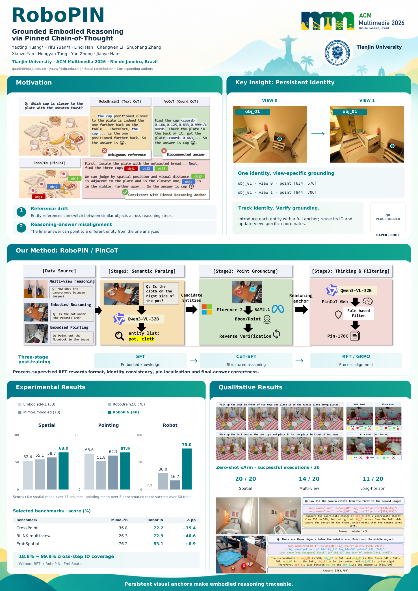

# 三版模块优化对照

用户反馈：目前显得别扭，信息密度和美观度不足。此次保留原始参考的五模块逻辑，实际生成并查看三套 PDF/PPTX，而非只讨论设计。

## 快速比较

| V1 精简版 | V2 均衡版 | V3 机制与证据版 |
|---|---|---|
|  |  |  |
| [PDF](../../output/variants/01-clean/RoboPIN_A0_portrait.pdf) · [PPTX](../../output/variants/01-clean/RoboPIN_A0_editable.pptx) | [PDF](../../output/variants/02-balanced/RoboPIN_A0_portrait.pdf) · [PPTX](../../output/variants/02-balanced/RoboPIN_A0_editable.pptx) | [PDF](../../output/variants/03-mechanism/RoboPIN_A0_portrait.pdf) · [PPTX](../../output/variants/03-mechanism/RoboPIN_A0_editable.pptx) |

[优化前](00-before.png)。当前主文件与 V3 内容相同。

## 逐模块发现与处理

| 模块 | 原版问题 | 当前处理 |
|---|---|---|
| 标题区 | RoboPIN 字标和装饰压住正文，页眉占高过多 | 字标由 155 pt 降至 112 pt；正文区域起点从 y175 调至 y153，作者保持 23 pt |
| 模块标题 | 图标大小、位置不一致，局部悬浮与重复装饰显得突兀 | 去除大徽章和无信息的图标，统一左对齐、字号与标题起点 |
| Motivation | 两条描述较长，与图中问题重复 | 保留原图；压缩为实体指代漂移和推理—答案脱节两个明确问题 |
| Key Insight | same ID 等语句重复，但缺少可操作表示 | V3 直接展示论文 obj_01 在 view 0 / view 1 的点坐标，再解释引入锚点和复用身份 |
| Method | 重复总结、留白挤压结果区；RFT 如何监督未说明 | 原图保持宽高比，训练流程压紧；V3 增加 format / identity consistency / pin localization / answer correctness 四个奖励维度 |
| Experimental | 实验区较矮，柱状图偏扁，只有平均数缺少具体对照 | 面板高 297 → 389 mm，绘图区 83 → 110 mm；增加 CrossPoint、BLINK multi-view、EmbSpatial 三行精选比较 |
| Qualitative | 三组小案例缩成图块，字号难以阅读 | 选取原论文前两组完整案例，宽度 198 → 379 mm；机器人任务成功数改为整齐的横向排布 |

## 三轮取舍

- **V1** 是保守清理，维持原有内容分布，主要减少装饰噪声；信息区比例仍有局限。
- **V2** 修正空间分配，提高证据区可读性。选择两组大案例，而不是继续把三组都缩小。
- **V3** 在 V2 的空间结构上补齐机制信息。它没有靠堆砌新段落增加密度，而是用已发表锚点表示和四类奖励替代重复口号，因此设为主版本。

以上是对实际渲染图的设计判断，不是外部视觉评测分数，也不代表用户已确认审美效果。

## 数据边界

- 所有总体成绩保持不变，机器人未报告基线仍为 n/a。
- 精选比较为 Mimo-Embodied 7B → RoboPIN 4B：CrossPoint 36.8 → 72.2（+35.4 pp），BLINK multi-view 26.3 → 72.9（+46.6 pp），EmbSpatial 76.2 → 83.1（+6.9 pp）。表内明确标注 Selected，不暗示所有基准都领先。
- obj_01 的 [634,576] / [844,706] 来自原论文相机视图示例，不是新预测。
- 定性图裁剪 PDF 第 8 页 Figure 4 的前两组完整示例，边界记录于 `assets/crop-provenance.json`；未重画或改写原图。
- 打印页的 Figure / Table 编号说明继续移除，来源保留在 `SOURCES.md` 和备注。

## 实际验证

每版均通过：单页 A0 尺寸、字体嵌入、页面边界、原生文字碰撞检查、原图比例与素材字节、PPTX ZIP 结构、11 根可编辑柱体及预期成绩检查。每版自己的 `validation.json` 位于其输出目录。未声称 Office 渲染或物理打样已经完成。

## 重建

```bash
python scripts/prepare_assets.py
python scripts/build_poster.py --variant clean --output-dir output/variants/01-clean
python scripts/validate_outputs.py --output-dir output/variants/01-clean
python scripts/build_poster.py --variant balanced --output-dir output/variants/02-balanced
python scripts/validate_outputs.py --output-dir output/variants/02-balanced
python scripts/build_poster.py --variant mechanism --output-dir output/variants/03-mechanism
python scripts/validate_outputs.py --output-dir output/variants/03-mechanism
```

不指定 `--output-dir` 时写入主输出目录；默认 `--variant mechanism`。
